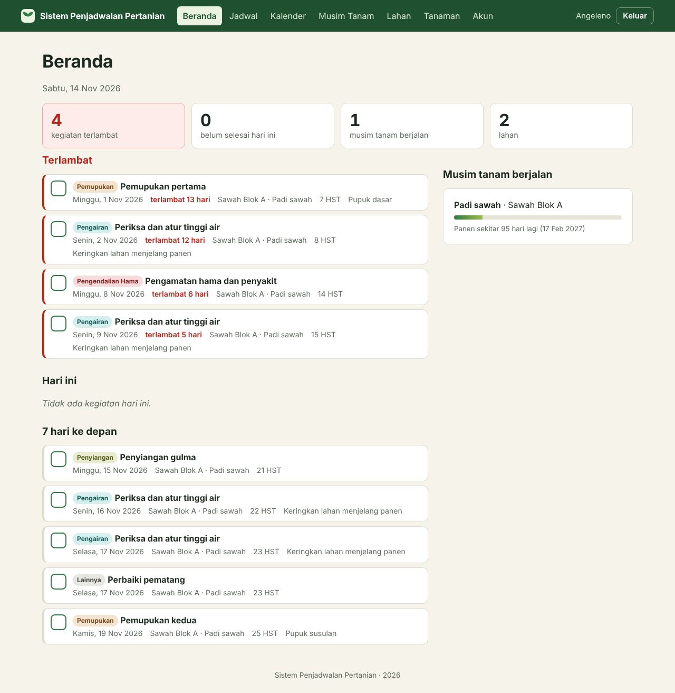
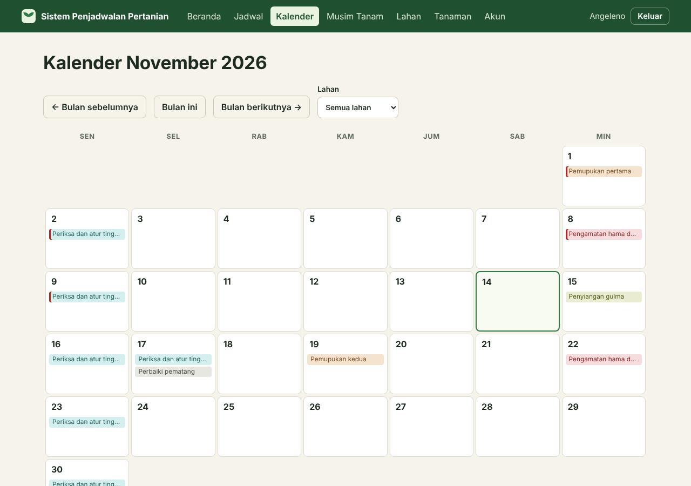
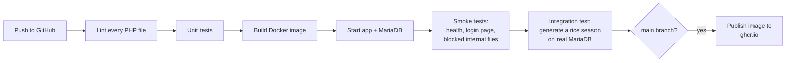
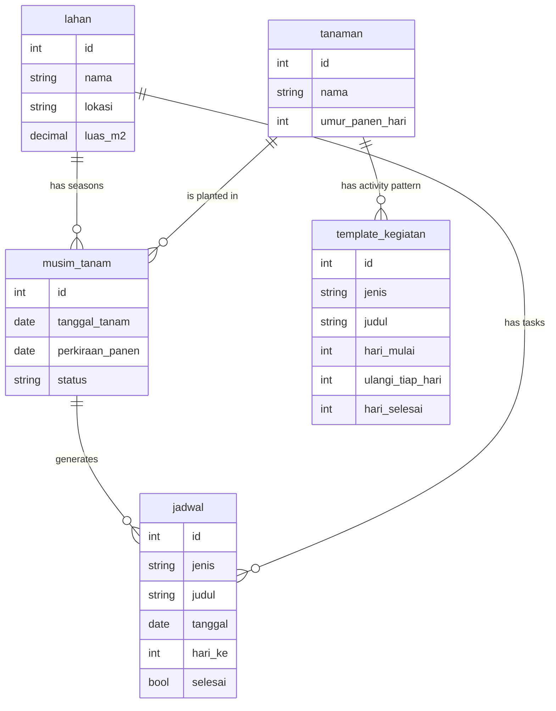

# Agricultural Scheduling System

[](https://github.com/lenohutapea/agricultural-scheduling-system/actions/workflows/ci.yml)

A PHP + MySQL web app that plans the whole crop cycle for a farm, from planting to harvest. Pick a field, a crop and a planting date, and it generates every task in between: watering, fertilizing, irrigation, weeding, pest checks and harvest.



> The interface is in Bahasa Indonesia, because it is built for farmers in Indonesia.

## Why

Small farms usually track their schedule in a notebook or in someone's head. A missed fertilizing round or a forgotten pest check can cost part of a harvest. This app turns a crop's routine into a dated, checkable schedule, so the farmer only has to open it and see what is due today.

## Features

- **Automatic schedule generation.** Each crop has a harvest age and a reusable activity pattern. Starting a growing season expands that pattern into dated tasks.
- **Dashboard.** Overdue tasks, today's tasks, the next 7 days, and a progress bar for every active season.
- **Task list.** Filter by date range, status, field and activity type; mark tasks done, reschedule them or add one-off tasks.
- **Monthly calendar.** Colour-coded by activity type, with overdue tasks flagged.
- **Fields, crops and seasons.** Full create, edit and delete, including cancelling a season, which removes its remaining future tasks.
- **Multiple user accounts** with password change.
- **Mobile friendly** and printable.
- **Runs in Docker** with one command, tested and published by a CI pipeline on every push.

## How scheduling works

Days are counted from the planting date (HST, *hari setelah tanam*, "days after planting"). A pattern says when an activity starts, how often it repeats, and when it stops. Planting (day 0) and harvest (the crop's harvest age) are added automatically.

Example with the bundled **rice (padi sawah)** pattern, harvest age 115 days:

| Activity | Rule | Days after planting | Tasks |
| --- | --- | --- | ---: |
| Planting | automatic | 0 | 1 |
| Irrigation check | every 7 days, day 1 to 100 | 1, 8, 15, …, 99 | 15 |
| Fertilizing | once each | 7, 25, 45 | 3 |
| Weeding | every 21 days, day 21 to 42 | 21, 42 | 2 |
| Pest and disease check | every 14 days, day 14 to 98 | 14, 28, …, 98 | 7 |
| Harvest | automatic | 115 | 1 |
| **Total** | | | **29** |

Starting a rice season on 1 March therefore creates 29 dated tasks ending with a harvest estimate on 24 June. The core logic lives in [`includes/jadwal.php`](includes/jadwal.php).

The bundled patterns for rice, corn and red chili are examples to start from. Adjust them to local agricultural extension advice.



## Tech stack

- **PHP 8.1+** with no framework
- **MySQL / MariaDB** through PDO
- Plain HTML and CSS, no JavaScript build step
- **Docker** and **Docker Compose** (PHP 8.3 + Apache, MariaDB 11.4)
- **GitHub Actions** for CI and image publishing to GitHub Container Registry

### Security

- Passwords hashed with `password_hash` / `password_verify`
- Every query uses prepared statements
- Every form carries a CSRF token
- All output escaped with `htmlspecialchars`
- Session ID regenerated on login; session cookie is `HttpOnly` and `SameSite=Lax`

## DevOps

### Pipeline

Every push and pull request runs the pipeline in [`.github/workflows/ci.yml`](.github/workflows/ci.yml):



- **Unit tests** ([`tests/run.php`](tests/run.php)) cover schedule generation, date math, and the security helpers.
- **Integration test** ([`tests/integration.php`](tests/integration.php)) runs inside the container against MariaDB: it creates a rice season, checks that exactly 29 tasks land on the right dates, then verifies cascade delete.
- **Health endpoint** `/healthz.php` returns `{"status":"ok"}` only when PHP and the database both respond. Docker uses it as the container healthcheck.
- The image runs with production `php.ini`, hides version headers, sends basic security headers, and refuses direct requests to `includes/` and config files.

### Running it as a server

The [`infra/`](infra/) folder runs the app on a Docker host with OpenTofu: Nginx in front, Prometheus and Grafana for monitoring, and an optional public HTTPS address through Cloudflare Tunnel. See [`infra/README.md`](infra/README.md).

### Roadmap

- [x] Containerize the app with Docker and Docker Compose
- [x] CI: lint, unit tests, container build, smoke and integration tests
- [x] Publish the image to GitHub Container Registry
- [ ] Provision an Oracle Cloud VM with OpenTofu (infrastructure as code)
- [ ] Continuous deployment to the VM from GitHub Actions
- [ ] Nginx reverse proxy with HTTPS
- [ ] Monitoring with Prometheus and Grafana

## Data model



| Table | Meaning |
| --- | --- |
| `lahan` | fields |
| `tanaman` | crops and their harvest age |
| `template_kegiatan` | a crop's repeating activity pattern |
| `musim_tanam` | a growing season: one crop on one field from one planting date |
| `jadwal` | dated tasks |
| `users` | accounts |

## Getting started

### With Docker (recommended)

Requires Docker with the Compose plugin.

```bash
git clone https://github.com/lenohutapea/agricultural-scheduling-system.git
cd agricultural-scheduling-system
cp .env.example .env        # then change the passwords in .env
docker compose up -d --build
```

Open `http://localhost:8080`. On the first visit you are asked to create the first account. The database schema and sample crops load automatically on the first start.

| Command | What it does |
| --- | --- |
| `docker compose ps` | show container status and health |
| `docker compose logs -f app` | follow the app logs |
| `docker compose down` | stop, keeping the data |
| `docker compose down -v` | stop and delete the data |

### Without Docker (Ubuntu)

```bash
sudo apt update
sudo apt install -y php-cli php-mysql mariadb-server

git clone https://github.com/lenohutapea/agricultural-scheduling-system.git
cd agricultural-scheduling-system

sudo mysql < database.sql
sudo mysql -e "CREATE USER 'pertanian'@'localhost' IDENTIFIED BY 'choose-a-password'; GRANT ALL ON pertanian.* TO 'pertanian'@'localhost';"

# local credentials, ignored by git
cat > config.local.php <<'PHP'
<?php
define('DB_USER', 'pertanian');
define('DB_PASS', 'choose-a-password');
PHP

php -S 0.0.0.0:8000
```

Open `http://localhost:8000`.

### Without Docker (Windows, XAMPP)

1. Clone or download this repository into `C:\xampp\htdocs\agricultural-scheduling-system`.
2. Start **Apache** and **MySQL** in the XAMPP Control Panel.
3. In `http://localhost/phpmyadmin`, open **Import** and import `database.sql`.
4. Open `http://localhost/agricultural-scheduling-system`. The default settings already match XAMPP (user `root`, no password).

### Configuration

Settings are read from environment variables, then from an optional `config.local.php`, then fall back to XAMPP defaults. See [`config.php`](config.php).

| Variable | Default |
| --- | --- |
| `DB_HOST` | `127.0.0.1` |
| `DB_PORT` | `3306` |
| `DB_NAME` | `pertanian` |
| `DB_USER` | `root` |
| `DB_PASS` | *(empty)* |
| `APP_TIMEZONE` | `Asia/Jakarta` |

### Running the tests

```bash
php tests/run.php
```

## Project structure

```
├── index.php             dashboard
├── jadwal.php            task list and filters
├── kalender.php          monthly calendar
├── musim.php             growing seasons, create a season
├── musim_detail.php      one season's full schedule
├── lahan.php             fields
├── tanaman.php           crops
├── tanaman_detail.php    a crop's activity pattern
├── tugas_aksi.php        task actions: done, reschedule, delete, add
├── akun.php              users and password
├── login.php, logout.php
├── healthz.php           health check endpoint
├── config.php            settings from environment variables
├── database.sql          schema and sample crops
├── assets/style.css
├── includes/
│   ├── bootstrap.php     loaded by every page
│   ├── db.php            PDO connection
│   ├── functions.php     security, flash messages, date helpers
│   ├── jadwal.php        schedule generation logic
│   └── layout.php        page layout and shared components
├── tests/
│   ├── run.php           unit tests
│   └── integration.php   database integration test
├── Dockerfile
├── docker-compose.yml
├── docker/apache.conf    Apache hardening
├── .env.example          Docker Compose settings template
├── infra/                OpenTofu: run the stack with Nginx and monitoring
└── .github/workflows/ci.yml
```

## Background

This started as my first-year final project at Institut Teknologi Del, where I was the team's project manager. The original code was lost, so I rebuilt the system from scratch in 2026 with a cleaner structure and automatic schedule generation.

## Author

**Angeleno Zuliano Hutapea** · [GitHub](https://github.com/lenohutapea) · [Portfolio](https://lenohutapea.github.io/portofolio/)
