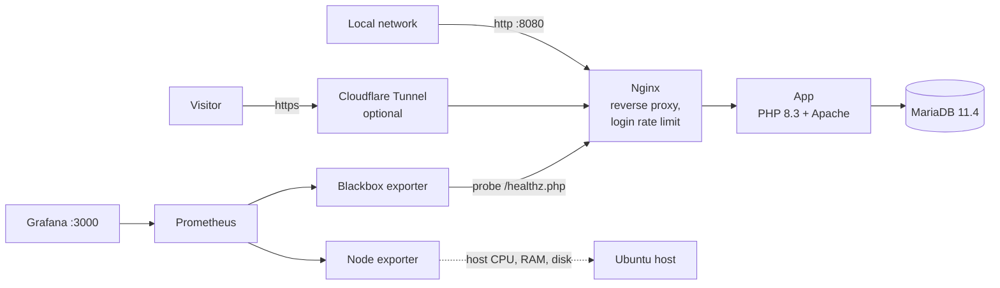
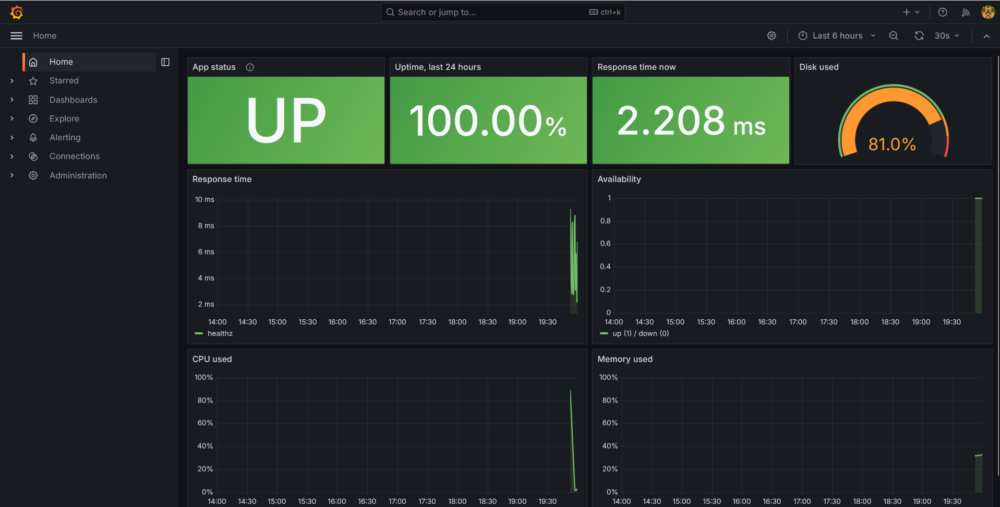

# Infrastructure

OpenTofu code that runs the whole system on a single Docker host (an Ubuntu machine), with a reverse proxy, monitoring and an optional public HTTPS address.



Everything is declared in code: the network, the volumes, seven containers and their configuration files. `tofu apply` creates or updates them; `tofu destroy` removes them.

| File | What it defines |
| --- | --- |
| `versions.tf` | OpenTofu version and the Docker provider |
| `variables.tf` | settings and passwords, with validation |
| `app.tf` | network, MariaDB, the app image from GHCR, Nginx |
| `monitoring.tf` | node-exporter, blackbox-exporter, Prometheus, Grafana |
| `tunnel.tf` | optional Cloudflare quick tunnel |
| `outputs.tf` | URLs and the running image digest |
| `config/` | Nginx, Prometheus and Grafana configuration |

## Requirements

- Docker Engine, with your user in the `docker` group
- OpenTofu 1.6 or newer
- The app image `ghcr.io/lenohutapea/agricultural-scheduling-system` set to **public** on GitHub, so it can be pulled without logging in

## Usage

```bash
cd infra
cp terraform.tfvars.example terraform.tfvars   # set your own passwords
tofu init
tofu plan
tofu apply
```

| Address | What |
| --- | --- |
| `http://localhost:8080` | the app, through Nginx |
| `http://localhost:3000` | Grafana (user `admin`) |

### Deploy a new version

After CI publishes a new image, run `tofu apply` again. It compares the digest of the `latest` image with the one that is running and replaces only the app container when they differ.

### Public address

1. Open the app and create your account first.
2. Set `enable_public_tunnel = true` in `terraform.tfvars` and run `tofu apply`.
3. Run `./tunnel-url.sh` to print the `https://*.trycloudflare.com` address.

Quick tunnels need no Cloudflare account, but the address changes whenever the tunnel restarts. A fixed address needs a Cloudflare account and a domain.

### Remove everything

```bash
tofu destroy
```

This deletes the containers, the network and the volumes, including the database.

## Monitoring



Grafana opens on the **Agricultural Scheduling System** dashboard:

- **App status** and **availability**: Prometheus asks the blackbox exporter to request `/healthz.php` through Nginx every 15 seconds. The endpoint answers `200` only when PHP and the database both work.
- **Uptime over 24 hours** and **response time**
- **CPU, memory and disk** of the host, from node-exporter

## Security notes

- Passwords live only in `terraform.tfvars` and in the local state file, both ignored by git. Variables are marked `sensitive`, so they do not appear in plan output.
- Only Nginx (8080) and Grafana (3000) are published on the host. MariaDB, the app and Prometheus are reachable only inside the Docker network.
- Nginx limits `login.php` to 10 requests per minute per client and hides its version.
